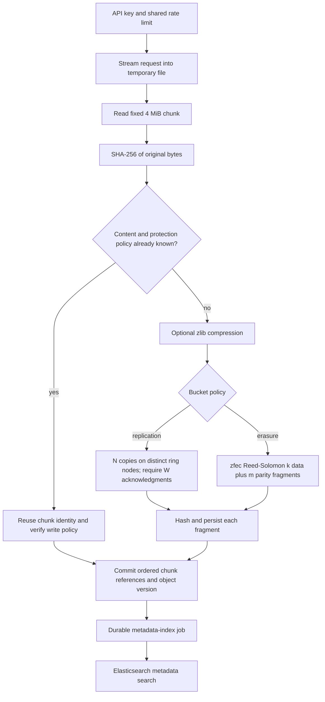
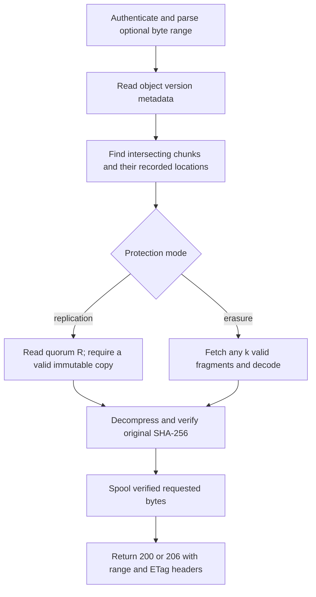
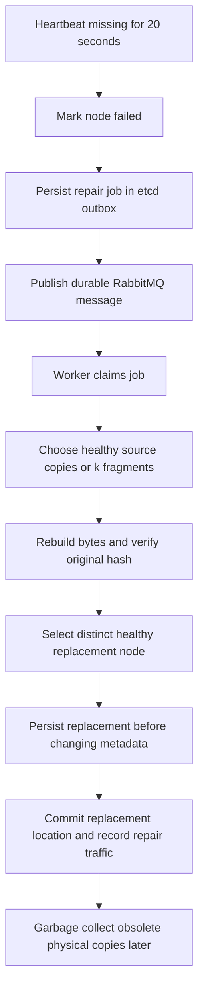
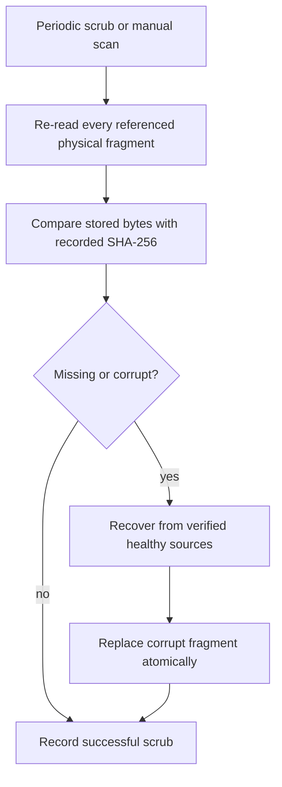

# Architecture and assignment coverage

## Components

The React console calls a FastAPI gateway through Nginx. Gateways share metadata
in a three-member etcd cluster. Storage nodes own independent persistent volumes
and expose hash-verified PUT, GET and DELETE chunk endpoints. A metadata control
plane receives heartbeats, marks missed-heartbeat nodes failed after 20 seconds,
and creates durable maintenance jobs. RabbitMQ distributes those jobs to workers.
Elasticsearch indexes latest object metadata for prefix, size, date and tag search.

The original parts 1-3 implementation is retained under `storage/` for reference;
the integrated application is under `framework/`. Earlier task-specific notes
describe the earlier SQLite stage and are superseded by this document.

## Write path

## Read path

## Failure and repair path

## Scrubbing path

## Coverage and limits

1. Python virtual environment, Git/GitHub remote and container tools are present.
2. Eight storage nodes, SHA-256 validation, disk persistence and heartbeats are implemented.
3. Fixed chunking, optional compression, version metadata, virtual-node consistent
   hashing and reference-counted deduplication are implemented and exercised.
4. Quorum replication, selectable zfec coding, failure relocation and background
   scrubbing are implemented. Small-workload repair measurements completed; the
   complete interrupted failure suite still requires a successful final rerun.
5. FastAPI bucket/object APIs, multipart/streaming, ranges, metadata, filters,
   API keys, shared rate limiting, cluster status and Swagger are implemented.
   Ten API tests passed; Elasticsearch testing awaits service readiness.
6. React browsing, upload/download, metadata, search and maintenance views are built.
   A real file upload was observed in the live UI. Search depends on Elasticsearch.
7. Bonus configuration includes Nginx, RabbitMQ workers, replicated etcd,
   Kubernetes StatefulSets and monitoring provisioning.
8. Bonus files include service Dockerfiles, Compose, Kubernetes manifests, HPA,
   deployment rendering and GitHub workflows. No remote cloud deployment is claimed.

This is a local educational implementation. Internal services rely on network
isolation and an internal key; transport TLS and multi-user authorization are not
configured. API keys grant workspace-wide access. Data remains hash-validated
during every read. Metadata operations use fenced etcd transactions; a single
logical metadata lock intentionally limits write concurrency for this lab.
