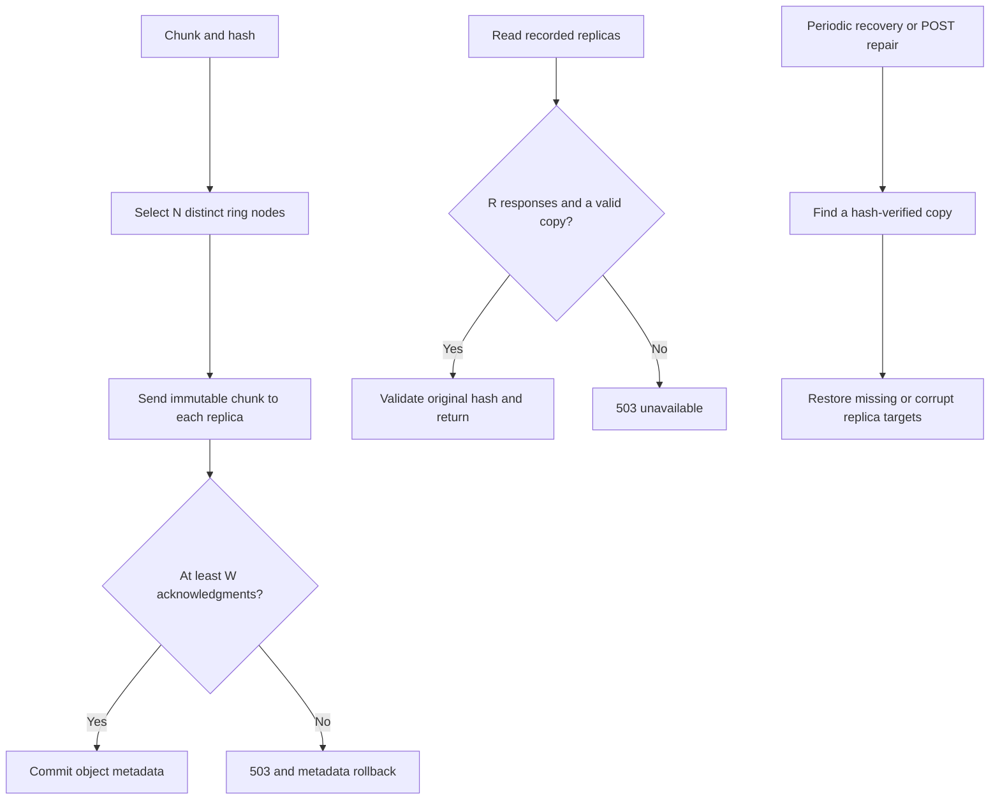

# Task 4: replication, quorums and replica recovery

The default configuration is N=3 replicas, W=2 write acknowledgments and R=2 read
responses. The service refuses invalid values: 1 <= W,R <= N <= configured node
count and W+R>N. The ring walks clockwise over virtual nodes and skips duplicate
physical nodes so each replica is on a different storage node.

## Configuration

Set these PowerShell variables before recreating the metadata service:

```powershell
$env:REPLICATION_FACTOR='3'
$env:WRITE_QUORUM='2'
$env:READ_QUORUM='2'
docker compose up -d --force-recreate metadata
```

`GET /config` displays the effective values. Each chunk records its replica set and
W/R policy. Changes apply to newly created chunks, preserving previous chunks'
quorum policy and locations. Changing existing data's replication factor requires
an explicit future migration. Use the same policy for the entire demonstration.

## Writes and reads

For each upload chunk, the coordinator attempts all N replica writes and commits
the object version only if at least W nodes acknowledge each chunk. Deduplicated
uploads also check write quorum by sending identical immutable bytes to the recorded
replicas. Failed quorum returns HTTP 503 and rolls back the object's metadata.
Incomplete writes may leave physical orphan chunks; a crash-safe orphan sweep is
outside this stage. No uncommitted object becomes visible.

A read contacts the recorded replica set, requires R valid node responses and at
least one integrity-checked copy. A missing-chunk response (404) counts as a response
but supplies no bytes; an unreachable or corrupt node does not count. Since W+R>N,
a read quorum intersects the acknowledged writes. Chunk contents are immutable, so
there are no conflicting mutable chunk versions to resolve. The coordinator also
checks the original content hash after decompression. Object versions and their
ordering are serialized in SQLite by the single metadata coordinator.

This is chunk-level quorum protection. Metadata itself remains a single point of
failure; the design does not claim a distributed metadata consensus protocol.
R/W apply to chunk reads/writes, not metadata listing/deletion. Empty objects have
no storage chunks and are held entirely in metadata.

## Recovery

Every ten seconds the metadata process checks referenced chunks, validates their
replicas and restores missing or corrupt replicas from an available good copy.
`POST /repair` triggers the same process immediately and returns repair counts.
An offline target is retried on the next cycle, including when it returns. Permanent
node replacement and live redistribution to a new replica set are not implemented.
Node heartbeats report node ID, URL, free disk bytes and chunk count every five
seconds; `/nodes` considers a node offline after 15 seconds without a heartbeat.

With N=3,W=2,R=2, losing one replica allows reads and writes; losing two rejects
both. This statement concerns the three selected replicas, not any arbitrary two
nodes out of the four-node cluster.



## Verification

```powershell
python tests/check_system.py
python tests/check_recovery.py
```

The recovery check temporarily stops two project storage nodes, restores them in a
finally block, removes one test replica, and corrupts one test replica. It checks
one-node availability, quorum rejection with two replicas down, and both forms of
recovery. Only a uniquely named test object is modified. Results are written to
`docs/recovery-verification.json`. Run from the project folder with Docker access.

The erasure-coding bullet visible on the supplied page is a separate, unfinished
task 4 requirement. This implementation covers the replication/quorum request.
