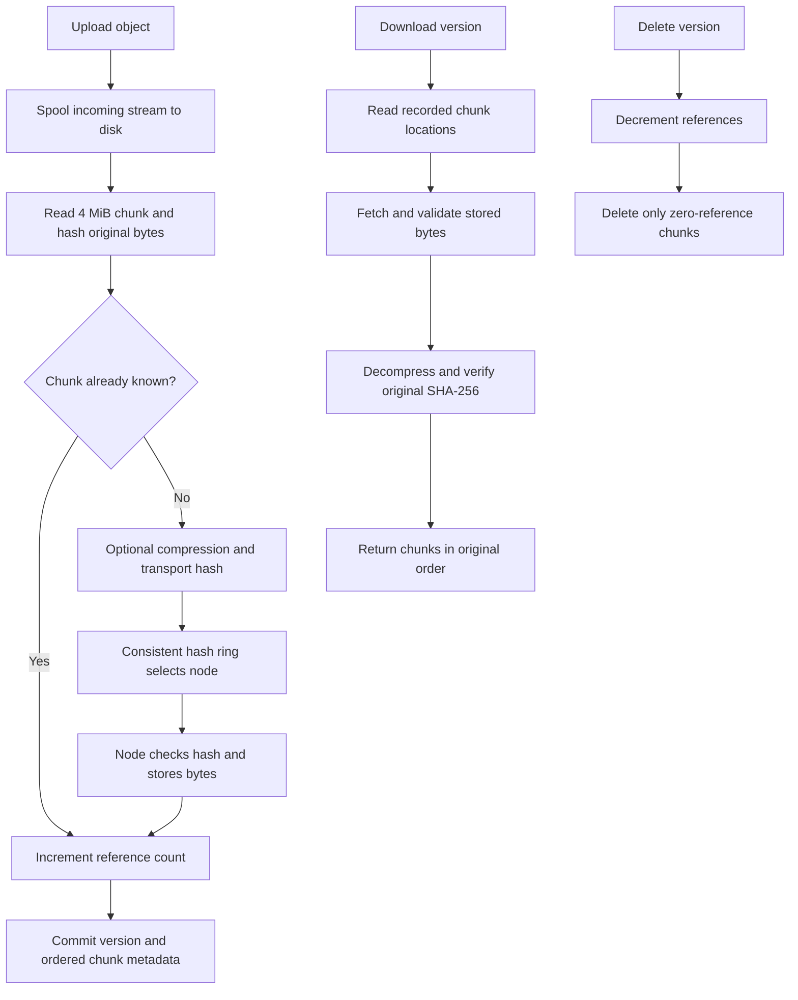

# Tasks 1–3: distributed object storage

## Run

From the project folder in PowerShell:

```powershell
.\.venv\Scripts\Activate.ps1
docker compose up -d --build
python tests/check_system.py
```

The external Docker network `distributed-net` must exist (already created on this computer).
Stop these project containers with `docker compose stop`. Named volumes retain data.
Do not use `docker compose down -v` unless you intend to erase the project data.

Metadata API and interactive documentation: http://localhost:8000/docs.
Four independent storage node APIs: http://localhost:8001/docs through
http://localhost:8004/docs. Each node has its own persistent Docker volume.

## Task 1

The existing Python 3.10 virtual environment and Git repository are used.
The Git remote is already configured for GitHub. Docker Desktop and its Kubernetes
cluster were verified during environment setup. This implementation runs in Docker
Compose. Kubernetes deployment is not part of tasks 1–3 as read from the supplied pages.
`requirements.txt` preserves the existing environment; `requirements-runtime.txt`
contains the dependencies used by the containers.

## Task 2

Storage nodes provide PUT, GET and DELETE `/chunks/{sha256}` and GET `/health`.
PUT rejects mismatched hashes; GET rechecks disk contents and returns 409 on corruption.
Writes use an atomic file replacement. A daemon thread sends a heartbeat every five
seconds; the metadata `/nodes` endpoint marks a node unavailable after 15 seconds.
Each node runs as a separate container. Heartbeats are observational and do not
remove failed nodes from the placement ring.

## Task 3

Uploads use fixed 4 MiB chunks, with optional zlib compression selected through
`?compress=true`. SHA-256 of the original bytes identifies deduplicated content.
Compressed bytes have a separate transport hash checked by the storage node.
SQLite stores bucket, key, monotonically increasing versions (including after deletion),
size, creation timestamp and ordered chunk hashes. The chunk table stores replica nodes,
encoding and reference count. Metadata operations are serialized in one API process.
Run one metadata worker; SQLite is persistent but is not a distributed metadata service.

The consistent hash ring uses 128 virtual nodes per physical node. Object placement
chooses distinct nodes for each chunk's replicas. The placement experiment compares four nodes with five
and three nodes over 20,000 hashes. It measures ownership changes; it does not migrate
live chunks or change the running cluster membership. Existing reads use recorded
locations. Runtime node migration and recovery belong to later work.

Identical chunks are stored once and counted once for each occurrence in an object
version. Deleting an object version decreases those counts. Only zero-reference chunks
are deleted. `/gc` retries deletion if a storage node was unavailable. Interrupted
uploads can leave unreferenced physical chunks; crash-safe orphan reconciliation is
not implemented in this stage.

## API examples

```powershell
Set-Content example.txt 'Hello distributed storage'
curl.exe -X PUT --data-binary '@example.txt' http://localhost:8000/objects/demo/example.txt
curl.exe http://localhost:8000/objects/demo/example.txt -o downloaded.txt
curl.exe http://localhost:8000/buckets/demo/objects?search=example
curl.exe http://localhost:8000/nodes
curl.exe http://localhost:8000/stats
curl.exe -X DELETE http://localhost:8000/objects/demo/example.txt
```

PUT creates a version; GET/DELETE select the latest version by default or accept
`?version=1`. Listing returns all retained versions. This is an S3-like HTTP interface,
not a complete AWS S3 protocol implementation.

## Flows



Replication and replica recovery were subsequently added as requested; see TASK-4.md.
Erasure coding is not implemented. This local lab has no authentication or TLS.
The final assignment also requests datasets, benchmarks and full-screen screenshots;
this stage supplies executable checks and machine-readable verification results,
not the final full-project report.
